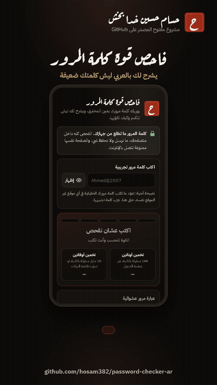

# فاحص قوة كلمة المرور | Arabic Password Strength Checker
**By [Hassam Hussain Khada Bakhsa](https://github.com/hosam382)**

جرّبها هنا: **https://hosam382.github.io/password-checker-ar/**



[شاهد فيديو الشرح كامل مع الموسيقى (MP4)](demo.mp4)

أداة تعليمية عربية تفحص قوة كلمة المرور وتشرح لك **ليش** هي ضعيفة، بنفس الطريقة اللي يفكر فيها المخترق. تشتغل كلها داخل المتصفح، وكلمة المرور ما تطلع من جهازك.

## وش يسوي

- يعطي كلمة المرور درجة من 0 إلى 4 (من «ضعيفة جداً» إلى «قوية جداً») مع مؤشر من 5 خانات.
- يقدّر وقت التخمين في حالتين: **أونلاين** (100 محاولة بالثانية عبر صفحة الدخول) و**أوفلاين** (10 مليار محاولة بالثانية لو تسرّبت قاعدة البيانات).
- يقسم كلمة المرور لقطع ويوريك كيف يشوفها المخترق: `Ahmed` اسم شائع، `@` حرف عشوائي، `2007` سنة.
- يشرح كل نقطة ضعف بالعربي، ويعطيك نصايح على حسب كلمتك.
- يولّد عبارة مرور عشوائية (4 إلى 6 كلمات + رقم + فاصل) باستخدام `crypto.getRandomValues`، ويشرح ليش عبارة المرور أقوى.

## وش يكشف

- **كلمات المرور المشهورة** (حوالي 170 كلمة من أشهر التسريبات): بدون فرق بين الحروف الكبيرة والصغيرة، وحتى لو أضفت أرقام أو رموز في الآخر. مثل `123456` و `Password1` و `password2024!`
- **تبديل الحروف برموز**: مثل `P@ssw0rd`
- **كلمة عربية مكتوبة والكيبورد إنجليزي** (حسب لوحة المفاتيح العربية 101): `hgsghl` = السلام، `lpl]` = محمد، `uf]hggi` = عبدالله. وحرف `b` يطلع «لا» (حرفين)، والفاحص يتعامل معه.
- **كلمة إنجليزية مكتوبة والكيبورد عربي**: `حشسسصخقي` = password
- **كلمات وأسماء عربية** مكتوبة بالعربي: مثل `السلام123`
- **أسماء شائعة** ونمط **«اسم + سنة»**: مثل `ahmed2007` و `Sara1999!`
- **التسلسلات**: `abc` و `1234` و `9876`
- **صفوف الكيبورد**: `qwerty` و `asdf` و `1qaz`
- **التكرار**: `aaaa` و `1111` و `123123`
- **السنوات والتواريخ**: الميلادية من 1950 إلى 2035، والهجرية من 1380 إلى 1460، وتواريخ مثل `15/08` و `15082007`
- **أرقام الجوال السعودية**: `05XXXXXXXX` و `9665XXXXXXXX` (مع + أو 00 أو بدونها)
- **الإيميل**: مثل `ahmed@gmail.com`
- **الطول وأنواع الحروف**: أقل من 8 خانات، أقل من 12، أو كلها أرقام

## الخصوصية

- كل الفحص يصير في `checker.js` داخل متصفحك. ما فيه سيرفر أصلاً.
- الصفحة ما تطلب أي شي من الإنترنت: الخطوط والصور داخل المشروع، وما فيه تحليلات ولا مكتبات خارجية.
- الصفحة فيها `Content-Security-Policy` مع `connect-src 'none'`، يعني المتصفح نفسه يمنعها من إرسال أي بيانات.
- ما نحفظ شي: لا `localStorage` ولا كوكيز، وخانة كلمة المرور فيها `autocomplete="off"`.
- فيه اختبار يتأكد إن الكود ما فيه أي أداة إرسال أو حفظ، ويشتغل مع باقي الاختبارات.
- ومع هذا كله: تعوّد ما تكتب كلمة مرورك الحقيقية في أي موقع غير الموقع نفسه. جرّب كلمة تشبهها.

## كيف يشتغل الحساب

1. ندوّر على كل الأنماط المعروفة داخل كلمة المرور. كل نمط له «تكلفة» بالبت، وهي log2 لعدد المحاولات اللي يحتاجها المخترق عشان يوصله. مثلاً السنة بين 1950 و 2035 فيها 86 احتمال، يعني تقريباً 6.4 بت بس.
2. الحروف اللي ما لها نمط نحسبها عشوائية: log2 لحجم مجموعة الحروف لكل خانة (أرقام 10، حروف صغيرة 26، وهكذا).
3. نختار أرخص تقسيم لكلمة المرور (برمجة ديناميكية)، لأن المخترق الذكي يمشي في أسهل طريق. الفكرة مستوحاة من مكتبة [zxcvbn](https://github.com/dropbox/zxcvbn) لكن بشكل أبسط بكثير.
4. قاموسنا صغير، فأي مقطع حروف «ينقرأ» مثل كلمة نعامله ككلمة من قاموس كبير. هذا يخلي التقدير متحفظ.
5. في عبارات المرور نحسب الفاصل مرة وحدة، وكل كلمة من قائمة المولّد (350 كلمة) تساوي تقريباً 8.5 بت.
6. الوقت = 2 أس عدد البتات ÷ سرعة التخمين. والدرجة: أقل من 25 بت = 0، أقل من 36 = 1، أقل من 50 = 2، أقل من 60 = 3، و60 أو أكثر = 4. كلمات المرور المشهورة دايماً 0، وأي كلمة أقصر من 8 خانات ما تتعدى 1.

**تنبيه:** التقدير تقريبي وتعليمي. قوائمنا صغيرة مقارنة بقوائم المخترقين الحقيقية (فيها ملايين الكلمات)، والسرعة الحقيقية تختلف حسب الموقع وطريقة حفظه لكلمات المرور.

## تشغيل الاختبارات

تحتاج [Node.js](https://nodejs.org) 20 أو أحدث، وما فيه مكتبات تنزّلها:

```
node --test
```

ولتشغيل الصفحة على جهازك (لازم سيرفر محلي لأن الصفحة تستخدم ES modules):

```
python -m http.server 8000
```

وبعدين افتح `http://localhost:8000`

## English

An educational, Arabic-first password strength checker that runs **100% in the browser**. The password is never sent or stored: there is no server, no analytics, no external requests, and the page ships a `Content-Security-Policy` with `connect-src 'none'`.

What it does:

- Scores a password 0 to 4 and estimates crack time for an online attack (100 guesses/s) and an offline attack (10 billion guesses/s).
- Shows how an attacker splits the password into patterns, and explains every weakness in plain Arabic.
- Detects common passwords (case-insensitive, also after stripping trailing digits/symbols), leetspeak, **Arabic words typed with the keyboard in English mode** (Arabic 101 layout, e.g. `hgsghl` = السلام, with `b` mapped to the two-letter لا), English words typed in Arabic mode, Arabic and Latin names, name + year, sequences, keyboard walks, repeats, Gregorian and Hijri years, dates, Saudi mobile numbers and emails.
- Estimates entropy with a minimum-cost segmentation over all matched patterns (a much simplified take on zxcvbn). Unknown pronounceable letter runs are treated as dictionary words, so the estimate stays conservative.
- Generates random passphrases (4 to 6 words from a 350-word list, plus a number, one capitalized word and a separator) using `crypto.getRandomValues` with rejection sampling.

Run the tests with `node --test` (Node.js 20+, no dependencies). The estimates are approximate and for learning only.

بُني بمساعدة الذكاء الاصطناعي (Claude) وراجعه حسام

Built with AI assistance (Claude), reviewed by Hassam.

## License

MIT. See [LICENSE](LICENSE).
